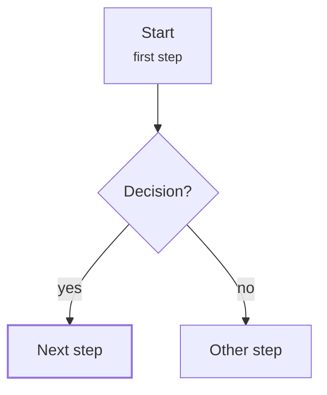

This is synthetic test content. It exercises every block the reader supports; real notes live in a private repository.

## State of play

| Front | Where it stands | Since |
| --- | --- | --- |
| Sample row | A [[sample-card|sample concept]] mentioned in a table | Jan 2026 |
| Second row | Plain text | Feb 2026 |

## Core

- A bullet with a [[sample-card|second link to the same card]].
- A bullet with an [external link](https://example.org).

## How it works



## Evidence bank

```chart
{
  "type": "line",
  "title": "A sample series rises over time",
  "x": { "field": "year", "min": 2000, "max": 2026, "ticks": [2000, 2010, 2020] },
  "y": { "min": 0, "max": 20, "ticks": [0, 10, 20], "unit": "%" },
  "series": [{ "field": "v" }],
  "rows": [{ "year": 2004, "v": 5 }, { "year": 2014, "v": 9 }, { "year": 2024, "v": 14 }],
  "source": "Synthetic fixture data"
}
```

## Prelims box

- Fixture fact one.
- Fixture fact two.
